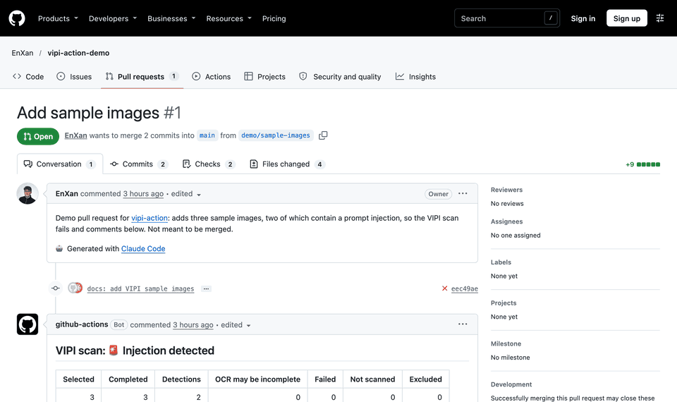
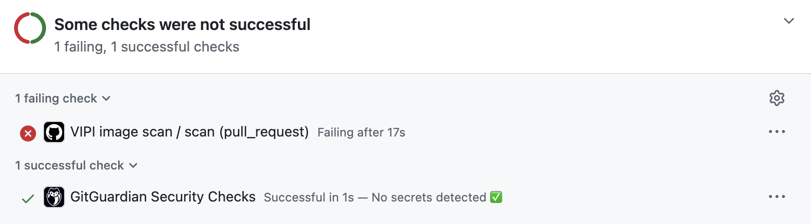
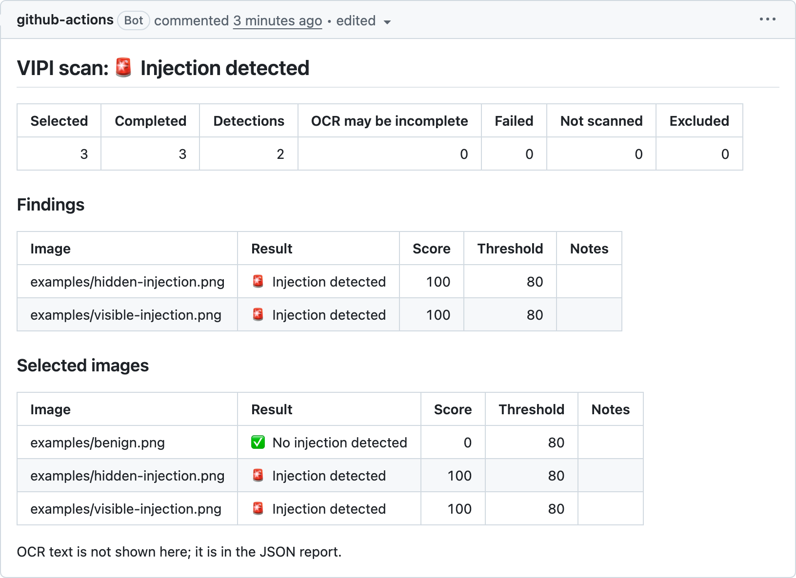

# VIPI Visual Prompt Injection Scan

GitHub Action for [VIPI](https://github.com/EnXan/VIPI): scans repository
images (PNG, JPEG, WebP and SVG) for visual prompt injections. It reads the text
in each image with OCR, re-reads unclear images, and checks the final text with
an injection detector. The text in an image's metadata (EXIF, XMP, PNG text,
IPTC), the payloads of QR codes and barcodes and text hidden in PNG pixels with
OpenStego are checked as well; an SVG scan also checks the file's source text.
An image with transparent pixels is also scanned on black and with alpha
dropped. In cloud mode, the same detector checks the whole image when the text
check finds no injection. A finding fails the job.

## Demo

A [real pull request](https://github.com/EnXan/vipi-action-demo/pull/1) that
adds two images with a prompt injection and one benign image. The scan fails
the check and the Action comments on the PR (`pr-comment: true`):







Screenshots and a scripted scroll through the PR page of an actual run,
cropped but not edited; how they were made is in
[docs/demo](docs/demo/README.md).

## Usage

Scan the images a pull request adds or changes. The default cloud mode uses
Google Cloud Vision for OCR and OpenAI for decisions:

```yaml
name: VIPI image scan
on:
  pull_request:
    branches: [main]
permissions:
  contents: read
jobs:
  scan:
    runs-on: ubuntu-latest
    steps:
      - uses: actions/checkout@v7
        with:
          fetch-depth: 0
      - uses: EnXan/vipi-action@v5
        env:
          GOOGLE_CLOUD_API_KEY: ${{ secrets.GOOGLE_CLOUD_API_KEY }}
          OPENAI_API_KEY: ${{ secrets.OPENAI_API_KEY }}
      - uses: actions/upload-artifact@v7
        if: always()
        with:
          name: vipi-report
          path: vipi-report.json
```

`fetch-depth: 0` is required: PR scans compare against the PR's base branch.
Outside PR events the Action scans all images under `paths`, unless `base-ref`
is set. Fork PRs normally get no secrets, so their cloud scans cannot reach the
providers.

The job exits with 0 when nothing was detected, 1 on a detection and 2 when a
scan is incomplete. Upload the report with `if: always()` to keep it in every
case.

> **Local mode on hosted runners:** standard GitHub-hosted runners have no GPU
> and too little memory for the local models. In our test, `balanced` took
> about 9 minutes for two images plus 2 minutes of setup, and `quality` could
> not load its model. Set `modus: local` only on self-hosted or larger
> runners. Local mode needs no provider key.

## Configuration

Everything is set in your workflow file (for example
`.github/workflows/vipi-scan.yml`), on the step that uses the Action. Inputs go
under `with:`, provider keys under `env:`, read from your repository secrets
(**Settings → Secrets and variables → Actions**). You never edit this
repository. Every input is optional; leave it out to use its default.

```yaml
      - uses: EnXan/vipi-action@v5
        with:                          # inputs, see the table below
          paths: |                     # several values: one per line
            docs/images
            assets
          exclude: |
            generated/
            *.webp
          ocr-provider: mistral
          decision-provider: jev
          threshold: 90
        env:                           # keys of the chosen providers
          MISTRAL_API_KEY: ${{ secrets.MISTRAL_API_KEY }}
          TYPESAFE_API_KEY: ${{ secrets.TYPESAFE_API_KEY }}
```

### Inputs

| Input | Default | Meaning |
| :-- | :-- | :-- |
| `paths` | `.` | Image files or directories to scan, one per line |
| `base-ref` | Unset | Base branch for diff scans outside PRs; PRs always use their actual base branch |
| `exclude` | Unset | Exclusion rules, one per line, applied after `.vipiignore` |
| `modus` | `cloud` | Full scan execution: `cloud` or `local` |
| `ocr-provider` | `google` | Cloud OCR: `google`, `openai` or `mistral`; ignored in local mode |
| `decision-provider` | Unset | Override the mode's decision model: cloud `openai` (default) or `jev`; local `clef-flash` or `d1` |
| `ocr-mode` | `quality` | Local profile: `speed`, `balanced` or `quality`; ignored in cloud mode |
| `detector` | `auto` | Injection detector. `auto` uses the decision model, including for the whole-image check in cloud mode |
| `threshold` | Unset | Finding score on a 0–100 scale; unset uses VIPI's default for the detector (80 for the cloud detectors) |
| `report-path` | `vipi-report.json` | JSON report path, also exposed as an output |
| `pr-comment` | `false` | Also post the summary as a pull request comment (see below) |
| `github-token` | `github.token` | Token for the pull request comment |
| `vipi-version` | `0.21.0` | `vipi-scanner` version installed from PyPI |
| `vipi-ref` | Unset | Testing only: install VIPI from this Git ref of `EnXan/VIPI` |

### Provider keys

Set only the keys of the providers you use, under `env:`:

| Provider | Used for | Key |
| :-- | :-- | :-- |
| `google` (default OCR) | OCR | `GOOGLE_CLOUD_API_KEY` |
| `openai` (default decisions) | OCR, review, detection | `OPENAI_API_KEY` |
| `mistral` | OCR | `MISTRAL_API_KEY` |
| `jev` | Review, detection | `TYPESAFE_API_KEY` |

The default cloud setup needs `GOOGLE_CLOUD_API_KEY` and `OPENAI_API_KEY`. A
missing key ends the scan before OCR with exit code 2 and names the variable.

## Outputs

| Output | Meaning |
| :-- | :-- |
| `selected-images` | Number of images selected for scanning |
| `report-path` | Path to the JSON report, including findings and scan errors |

## Job summary

After every run, including failed ones, the Action writes a summary to the
job page: the overall result, counts, findings, errors, every selected image
with its score (rounded to one decimal) and threshold, and the images excluded
by your rules. Non-image files and built-in exclusions are left out. Images whose OCR text
may be incomplete are marked. OCR text is not shown; it stays in the JSON
report. File names are escaped, so they cannot change the page.

### Pull request comment

Set `pr-comment: true` to also post a short summary as a comment on the pull
request: the counts, findings, errors and images whose result may be
incomplete. Images without findings are only counted, with a link to the job
summary that lists them. The Action keeps one comment and updates it on every
run; it creates none while a PR selects no images. Your workflow needs write
access to pull requests:

```yaml
permissions:
  contents: read
  pull-requests: write
```

Pull requests from forks only get a read-only token, so they cannot comment;
the Action then prints a warning and the scan result is unchanged. Comments
are limited to about 65,000 characters, so large reports show findings and
errors only.

## Excluding images

Put a [`.vipiignore`](https://github.com/EnXan/VIPI/blob/main/.vipiignore.example)
in the repository root, or pass rules with `exclude`. PR scans read
`.vipiignore` from the base branch, so a PR cannot exempt its own images; a
change to the file applies after it is merged. The `exclude` input comes from
the workflow file, which `pull_request` events take from the PR itself. See
[excluding images](https://github.com/EnXan/VIPI/blob/main/docs/cli.md#excluding-images).

Each SVG file runs OCR and detector checks of its rendered and source text.
Cloud scans also make a billable image request when neither text check finds an
injection. To skip SVG files, for example a large icon set, add `*.svg` (or the icon
folder) to `.vipiignore` or `exclude`. How SVG files are read and rendered is in
[SVG files](https://github.com/EnXan/VIPI/blob/main/docs/cli.md#svg-files).

## How it works

The Action installs a pinned `vipi-scanner` release from PyPI into an isolated
environment. It runs `vipi scan --list-only` first and prepares models only
when images are selected; models are downloaded each run and not cached.
Local mode installs the CPU builds of PyTorch on Linux and Windows.

## Versions

Use `@v5`. Its initial release pins `vipi-scanner` 0.21.0, which also scans
images with transparent pixels on black and with alpha dropped, and checks
text hidden in PNG pixels with OpenStego. These checks can change findings;
the extra views add OCR and detector requests for each distinct view in cloud
mode, and an OpenStego payload adds a detector request. `detector: prompt-guard` no longer exists; use
`detector: wolf-defender`, which needs no `HF_TOKEN`. Both changes ship in a
new Action major. Use `@v4` for the previous behavior with `vipi-scanner`
0.18.0 (metadata and code checks, no transparency views or OpenStego check), `@v3` for
`vipi-scanner` 0.15.0, `@v2` for 0.14.1 and `@v1` for 0.13.0, before SVG
support.

`vipi-version` lets you choose an explicit scanner release. VIPI's ADRs
describe the
[image check](https://github.com/EnXan/VIPI/blob/main/adr-code/0082-cloud-image-check-without-image-only-scans.md),
the [metadata check](https://github.com/EnXan/VIPI/blob/main/adr-code/0083-image-metadata-reading.md),
the [QR and barcode check](https://github.com/EnXan/VIPI/blob/main/adr-code/0084-barcode-reading.md),
the [transparency views](https://github.com/EnXan/VIPI/blob/main/adr-code/0085-transparency-views.md),
[Wolf Defender](https://github.com/EnXan/VIPI/blob/main/adr-code/0087-wolf-defender-replaces-prompt-guard.md),
the OpenStego checks ([legacy](https://github.com/EnXan/VIPI/blob/main/adr-code/0088-legacy-openstego-reading.md),
[RandomLSB](https://github.com/EnXan/VIPI/blob/main/adr-code/0089-openstego-random-lsb-reading.md))
and the Action's
[major-version policy](https://github.com/EnXan/VIPI/blob/main/adr-code/0076-action-threshold-follows-detector-default.md).

## Development

`.github/workflows/test.yml` runs the Action against fixture Git repositories,
without secrets or model downloads, on every PR, on pushes to `main` and
manually:

- **On every run:** an empty diff, rules from the base branch, a rule change on
  the PR branch, and the `exclude` input.
- **On PRs from this repository:** `pr-comment` posts a real comment, a second
  run must update it instead of adding one, and the test deletes it again.
- **Unit tests:** the summary and comment scripts with fixture reports and a
  fake GitHub API (`tests/test_*.py`).
- **On pushes and manual runs:** a scan without diff (`base-ref` unset), which
  PR events cannot test because they always compare against the PR base.

Images that remain run in cloud mode without keys, so they fail before OCR.
The fixture verifies selection, the report and the cloud evidence scope.

Run the workflow manually (**Actions → Test action → Run workflow**) with:

- `vipi-ref` to test an unreleased VIPI branch or commit;
- `cloud-scan` to also scan [two test images](tests/images) with the default
  providers and check that the injection is detected and the benign image is
  not. This is paid (about $0.01 per run) and needs the repository secrets
  `GOOGLE_CLOUD_API_KEY` and `OPENAI_API_KEY`.

Release: bump `vipi-version`'s default to the new PyPI release, let the tests
pass, tag `vX.Y.Z` and set the matching major alias.

## License

[Apache License 2.0](LICENSE)
